# Directorio de espacios · UAM Cuajimalpa

> Práctica 1 · App móvil con API REST, usuarios y Docker

Aplicación móvil para registrar y consultar espacios de la Unidad Cuajimalpa de la Universidad Autónoma Metropolitana. Una persona visitante puede crear una cuenta o iniciar sesión; con una sesión válida puede crear, consultar, editar y eliminar registros de espacios.

## Datos de la práctica

| Dato | Información |
| --- | --- |
| UEA | Administración de Proyectos de Software (1151055) |
| Trimestre | 26-O · otoño de 2026 |
| Profesor | M. en C. Gabriel Hurtado Avilés |
| Entrega | 20 de octubre de 2026, 23:59 h |

### Integrantes

| Integrante | Matrícula |
| --- | --- |
| Max Uriel Sánchez Díaz | 2213026327 |
| Daniela Nava Martínez | 2223028762 |
| Bryan Tonatiuh Ochoa De La Cruz | 2223028771 |

## Introducción

El proyecto implementa el esqueleto técnico del proyecto integrador: una app Android en Kotlin que consume una API REST propia. El recurso elegido es `lugares`, porque permite administrar aulas, laboratorios, cubículos, talleres y otros espacios de la Unidad Cuajimalpa.

Se eligió **Kotlin con Jetpack Compose** para el cliente móvil por su integración nativa con Android y porque permite construir una interfaz declarativa. La comunicación se realiza con **Retrofit**; el backend usa **Node.js con Express** y **PostgreSQL**, ejecutados en contenedores mediante Docker Compose. Esta separación permite que el cliente nunca se conecte directamente a la base de datos.

## Arquitectura y tecnologías

```text
App Android (Kotlin + Compose + Retrofit)
          │  HTTP + Authorization: Bearer <JWT>
          ▼
API REST (Node.js + Express)
          │
          ▼
PostgreSQL 16 (contenedor Docker)
```

| Capa | Tecnología | Función |
| --- | --- | --- |
| Cliente móvil | Kotlin, Jetpack Compose, Retrofit | Registro, inicio de sesión y CRUD de espacios. |
| API | Node.js 22, Express 4 | Endpoints REST, validación y autorización. |
| Autenticación | bcryptjs, JSON Web Token | Hash de contraseñas y tokens con caducidad. |
| Datos | PostgreSQL 16.4-alpine | Persistencia de usuarios y lugares. |
| Contenedores | Docker Compose | Levanta API y base de datos desde cero. |

## Funcionalidad

- Registro de cuentas con correo y contraseña de al menos ocho caracteres.
- Inicio de sesión que devuelve un JWT con caducidad configurable.
- Persistencia local del token de la sesión en Android.
- CRUD de `lugares`: crear, listar, consultar por identificador, editar y eliminar.
- Filtro por edificio y búsqueda por nombre, edificio, piso o descripción.
- Estados de interfaz: carga, error de conexión, lista vacía y sesión caducada.
- Cierre de sesión; si la API responde `401`, la app borra el token y vuelve al acceso.

## API REST

URL base local: `http://localhost:5000`

Las rutas de `lugares` requieren la cabecera `Authorization: Bearer <token>`. Sin token, con token alterado o con token caducado, la API responde `401`.

| Método | Ruta | Autenticación | Cuerpo / parámetro | Respuesta esperada |
| --- | --- | --- | --- | --- |
| `POST` | `/registro` | No | `email`, `password` | `201` con el usuario creado. |
| `POST` | `/login` | No | `email`, `password` | `200` con JWT. |
| `POST` | `/lugares` | Sí | `nombre`, `edificio`, `piso`, `descripcion` | `201` con el lugar creado. |
| `GET` | `/lugares` | Sí | — | `200` con la lista. |
| `GET` | `/lugares/:id` | Sí | `id` en la ruta | `200` con el lugar o `404`. |
| `PUT` | `/lugares/:id` | Sí | Datos completos del lugar | `200` con el lugar actualizado. |
| `DELETE` | `/lugares/:id` | Sí | `id` en la ruta | `200` con el mensaje de eliminación. |

### Ejemplos de uso

Crear una cuenta:

```bash
curl -X POST http://localhost:5000/registro \
  -H "Content-Type: application/json" \
  -d '{"email":"alumna@uam.mx","password":"contrasena-segura"}'
```

```json
{
  "id": 1,
  "email": "alumna@uam.mx"
}
```

Iniciar sesión:

```bash
curl -X POST http://localhost:5000/login \
  -H "Content-Type: application/json" \
  -d '{"email":"alumna@uam.mx","password":"contrasena-segura"}'
```

```json
{
  "token": "<jwt>"
}
```

Crear un lugar:

```bash
curl -X POST http://localhost:5000/lugares \
  -H "Authorization: Bearer <jwt>" \
  -H "Content-Type: application/json" \
  -d '{"nombre":"Cafetería","edificio":"A","piso":2,"descripcion":"Área de alimentos"}'
```

```json
{
  "id": 1,
  "nombre": "Cafetería",
  "edificio": "A",
  "piso": 2,
  "descripcion": "Área de alimentos",
  "creado_en": "2026-10-18T00:00:00.000Z"
}
```

Consultar lugares:

```bash
curl http://localhost:5000/lugares \
  -H "Authorization: Bearer <jwt>"
```

Actualizar un lugar:

```bash
curl -X PUT http://localhost:5000/lugares/1 \
  -H "Authorization: Bearer <jwt>" \
  -H "Content-Type: application/json" \
  -d '{"nombre":"Cafetería","edificio":"A","piso":2,"descripcion":"Horario de 08:00 a 18:00"}'
```

Eliminar un lugar:

```bash
curl -X DELETE http://localhost:5000/lugares/1 \
  -H "Authorization: Bearer <jwt>"
```

```json
{
  "mensaje": "Lugar eliminado"
}
```

### Códigos de respuesta

| Código | Uso en la API |
| --- | --- |
| `200` | Inicio de sesión, lecturas, actualizaciones y eliminación correctas. |
| `201` | Registro o creación de un lugar correctos. |
| `400` | Datos faltantes, inválidos o correo previamente registrado. |
| `401` | Credenciales inválidas o sesión ausente, alterada o caducada. |
| `404` | Un lugar solicitado no existe. |
| `500` | Error no controlado del servidor. |

## Cómo levantar el proyecto

### Requisitos

- Docker Desktop con Docker Compose.
- Android Studio con SDK y emulador Android, o un teléfono Android con depuración USB.
- JDK 11 o posterior para la app Android.

### 1. Configurar variables de entorno

Desde la raíz del repositorio, crea un archivo `.env` a partir del ejemplo. **No subas `.env` al repositorio.**

```powershell
Copy-Item .env.example .env
```

Edita al menos `DB_PASSWORD` y `JWT_SECRET` antes de levantar el sistema.

### 2. Levantar API y base de datos

```bash
docker compose up -d --build
docker compose ps
```

La API queda publicada en el puerto `5000` y PostgreSQL permanece dentro de la red de Docker. Para revisar el arranque:

```bash
docker compose logs -f api
```

Para detener los servicios:

```bash
docker compose down
```

### 3. Ejecutar la app Android

Abre la carpeta [`app/`](app/) en Android Studio, inicia un emulador y ejecuta la configuración `app`. También se puede compilar desde la terminal:

```powershell
Set-Location app
.\gradlew.bat installDebug
```

La URL base del cliente Android se encuentra en [`app/app/src/main/java/com/uam/lugaresapp/data/ApiClient.kt`](app/app/src/main/java/com/uam/lugaresapp/data/ApiClient.kt):

```kotlin
const val BASE_URL = "http://10.0.2.2:5000/"
```

`10.0.2.2` permite que el emulador de Android llegue al `localhost` de la computadora anfitriona. En un teléfono físico se debe reemplazar por la IP local del equipo que ejecuta Docker, por ejemplo `http://192.168.1.50:5000/`.

La app declara el permiso `INTERNET` y `android:usesCleartextTraffic="true"` para permitir las pruebas locales por HTTP. En un despliegue real se debe usar HTTPS.

## Evidencia visual · cliente Kotlin

Las capturas se almacenan en [`docs/capturas/kotlin/`](docs/capturas/kotlin/). Corresponden a la versión Android desarrollada en Kotlin con Jetpack Compose.

| Directorio con registro | Alta de espacio |
| --- | --- |
| 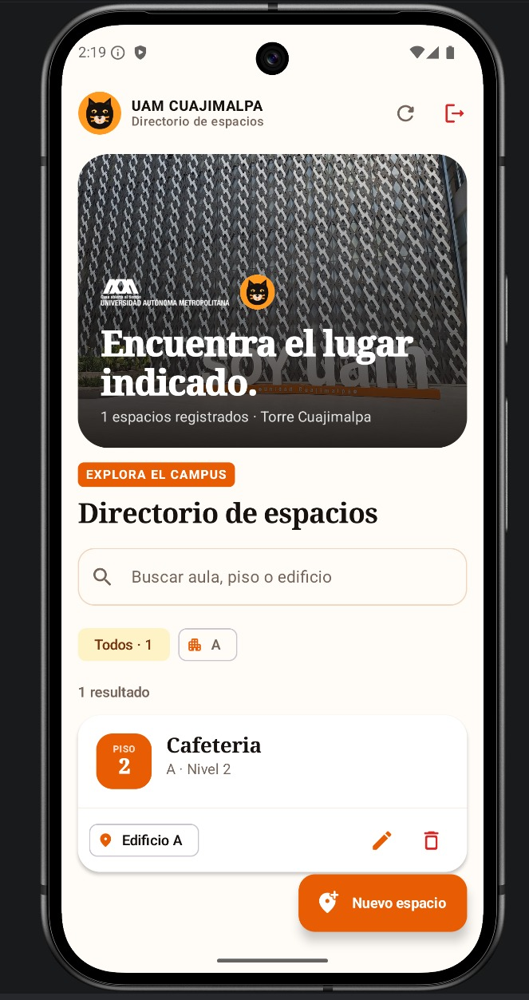 | 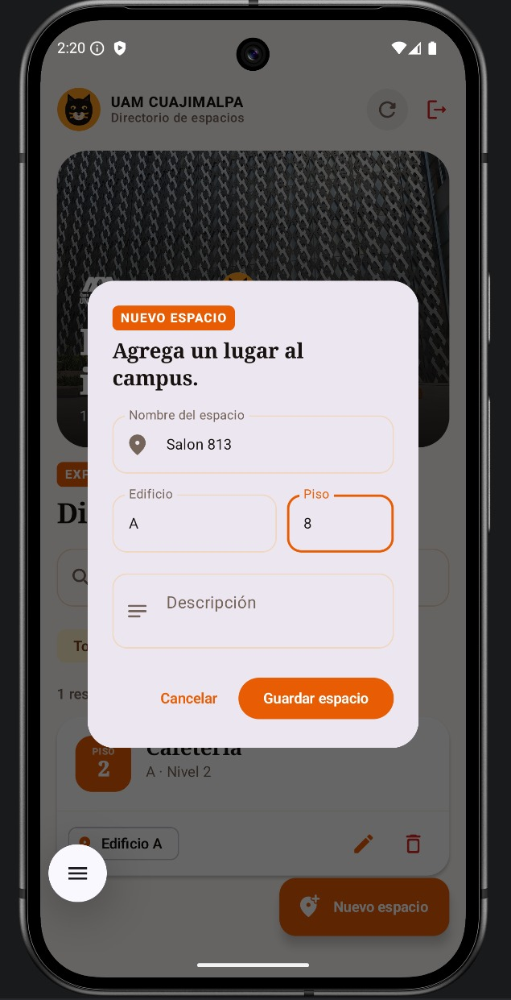 |
| Lista vacía | Registro |
| 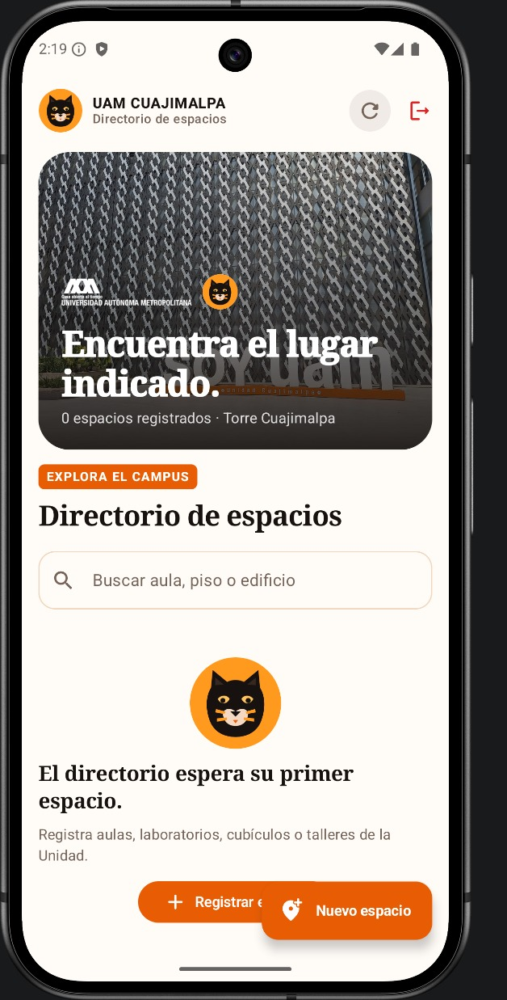 | 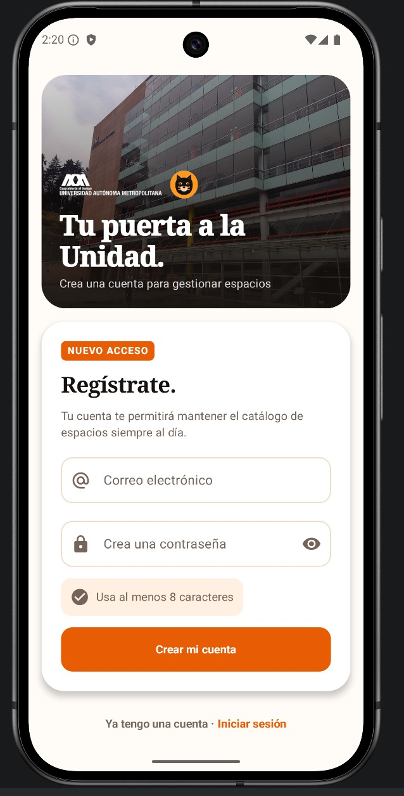 |
| Inicio de sesión | Búsqueda y filtrado |
| 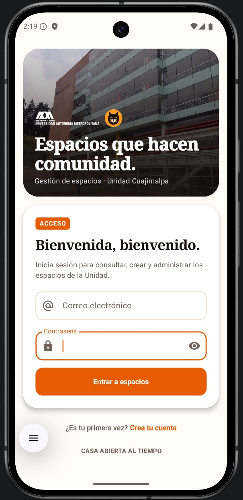 | 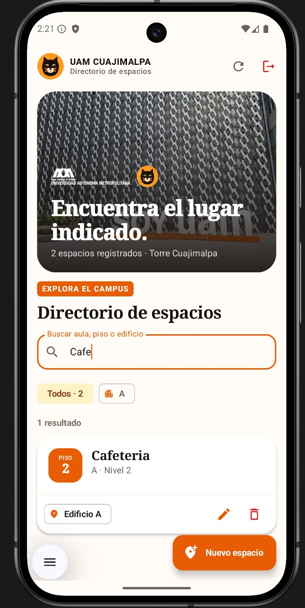 |
| Credenciales incorrectas | Validación de contraseña |
| 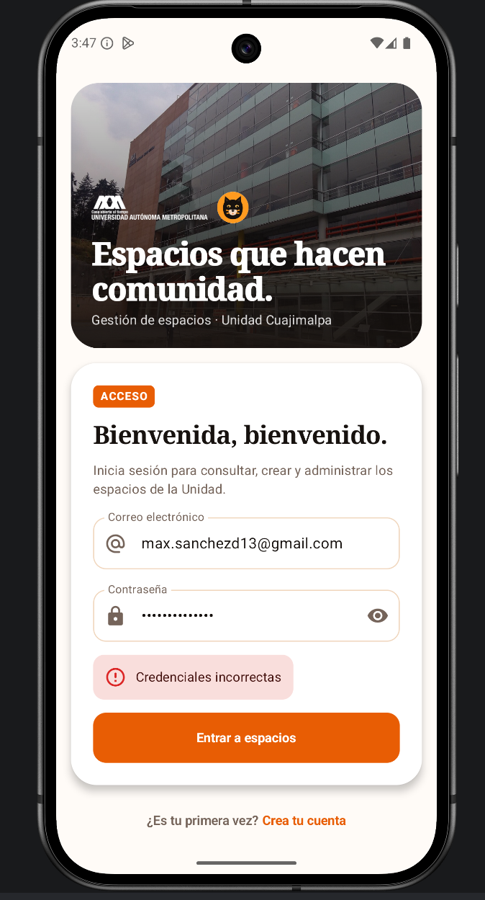 | 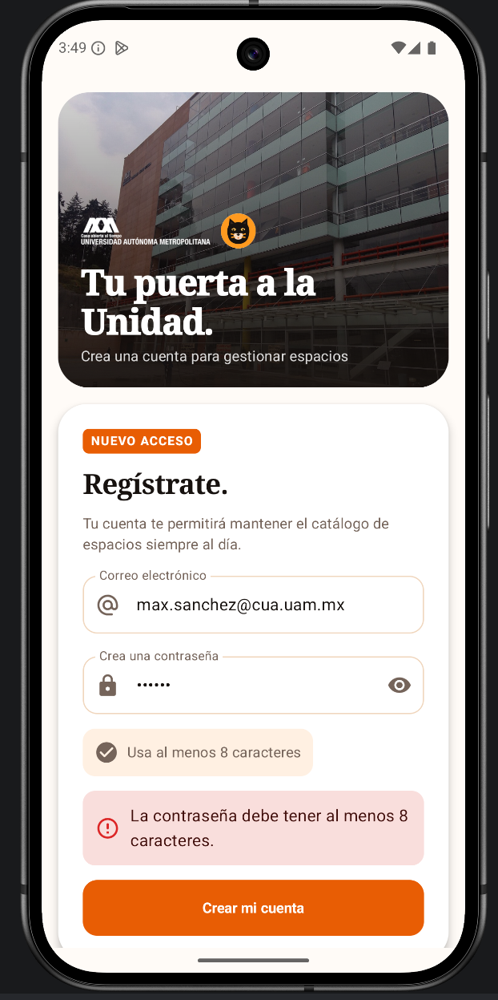 |

**Confirmación para cerrar sesión**

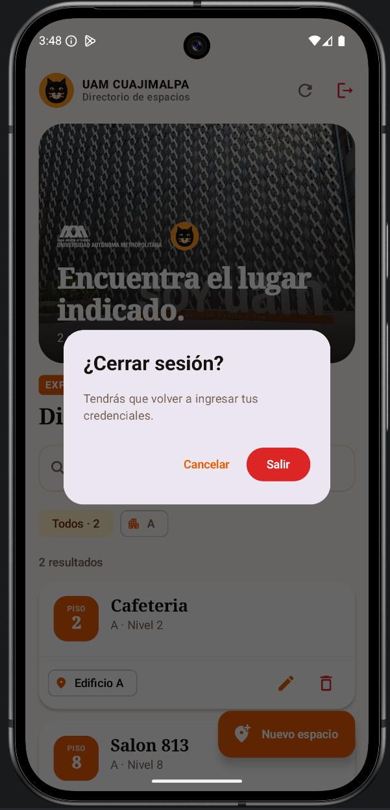

## Evidencia visual · cliente Flutter

Las capturas se almacenan en [`docs/capturas/flutter/`](docs/capturas/flutter/). Corresponden al cliente en Flutter del ejercicio 4, que incluye inicio de sesión y lista de lugares.

| Credenciales incorrectas | Lista de lugares |
| --- | --- |
| 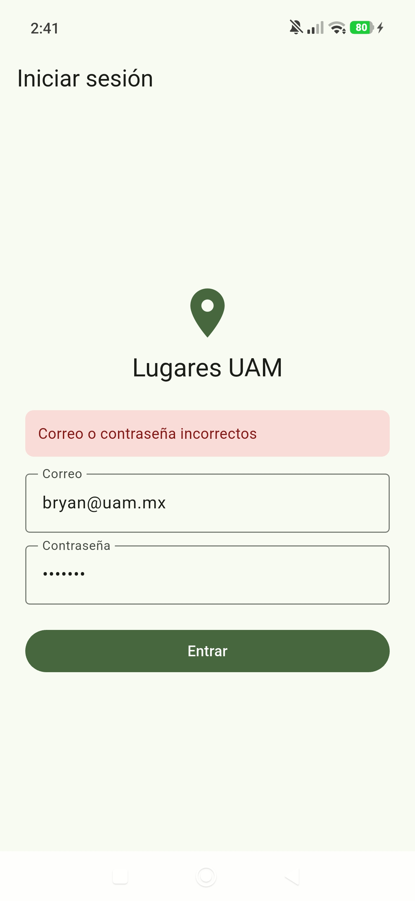 | 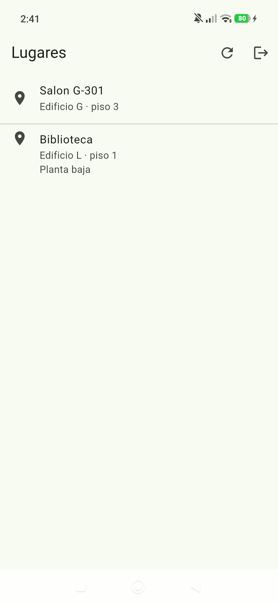 |
| Lista vacía | Error de conexión |
| 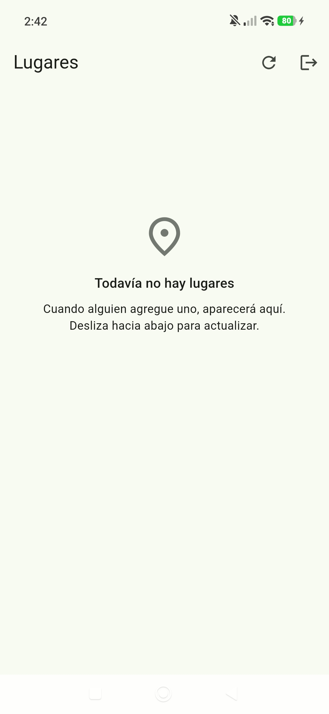 | 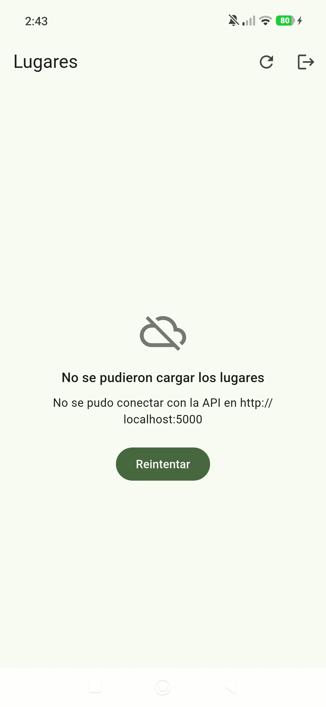 |
| Conexión recuperada | Sesión caducada |
| 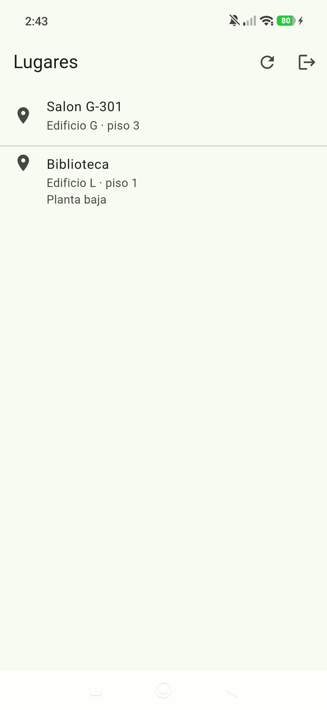 | 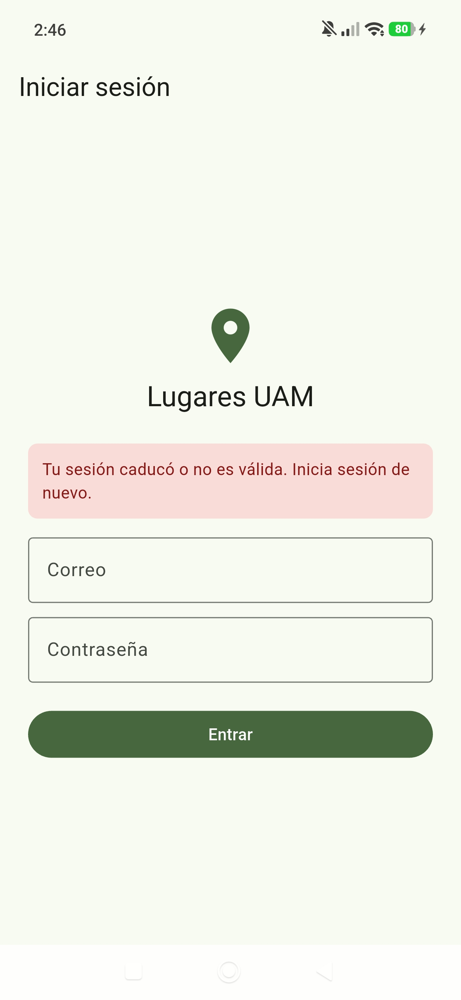 |

## Seguridad y datos

- Las contraseñas no se guardan en texto plano: se procesan con `bcryptjs` y un costo de hash de 10.
- La API firma los JWT con `JWT_SECRET` y usa `JWT_EXPIRES_IN` para su caducidad.
- El interceptor de Retrofit adjunta el token a cada petición protegida mediante `Authorization: Bearer <token>`.
- El token se conserva localmente en `SharedPreferences` y se borra si el usuario cierra sesión o recibe un `401`.
- Las credenciales de Docker y la llave JWT se leen desde `.env`; el archivo versionado es únicamente [`.env.example`](.env.example).

## Trabajo en equipo

El repositorio usa issues para identificar pantallas y endpoints. Los cambios se desarrollan en ramas y se integran a `main` mediante Pull Request ligado al issue correspondiente y revisado por otra persona integrante del equipo.

## Comparación: Kotlin y Flutter

El cliente de Kotlin (`app/`) y el de Flutter (`app_flutter/`, ejercicio 4) consumen la misma API.

| | Kotlin (Jetpack Compose) | Flutter |
| --- | --- | --- |
| Lenguaje | Kotlin | Dart |
| Código compartido | Solo Android (app nativa) | Un mismo código para varias plataformas; aquí se probó solo en Android |
| Tiempo de compilación, primera vez | 1 min 2 s | 1 min 21 s |
| Tiempo de compilación, desde cero | 23 s | 15 s |
| Tiempo de compilación, incremental | 20 s | 6 s |
| Qué costó más | Conectar la app en el celular con la API que corre en Docker: hubo que crear el túnel USB con `adb reverse`, permitir tráfico HTTP sin cifrar y declarar el permiso de Internet en el manifiesto. | Configurar la conexión con la API: la dirección cambia según el dispositivo (`10.0.2.2` en el emulador, la IP local en un celular físico), por lo que se dejó configurable con `--dart-define=API_URL`, y hubo que permitir tráfico HTTP sin cifrar y declarar el permiso de Internet en el manifiesto. |

Los tiempos de Kotlin se midieron con `.\gradlew.bat clean assembleDebug` (primera vez y desde cero) y `.\gradlew.bat assembleDebug` tras cambiar un texto (incremental), en una computadora con procesador Intel Core i5-11400H de 11.ª generación, 8 GB de RAM y Windows. Los tiempos de Flutter se midieron en la misma computadora con `flutter build apk --debug` (primera vez, tras `flutter clean` y tras cambiar un texto), por lo que son comparables entre sí.

## Conclusiones

Esta práctica permitió integrar en un solo flujo la persistencia en PostgreSQL, el levantamiento reproducible con Docker Compose, la autenticación con JWT y un cliente Android conectado a una API propia. Los retos principales fueron configurar la comunicación entre el emulador y la API local —resuelto con `10.0.2.2`— y asegurar que las acciones del CRUD dependieran de una sesión válida. La separación entre cliente, API y base de datos facilita probar cada capa y proporciona una base para el proyecto integrador.

## Práctica 3 · Mi parte del campus

El equipo trabaja en la Unidad Cuajimalpa, en [`campus-cuajimalpa/`](campus-cuajimalpa/), carpeta copiada del repositorio de ejemplo del profesor (Hurtado Avilés, 2026). Cada integrante perfecciona una parte del croquis y planea cómo fotografiarla; cada parte tiene su issue, su rama `feature/<issue>-<parte>` y su Pull Request, revisado y aprobado por otro integrante. Todo se registra en el milestone «Práctica 3 · Mi parte del campus».

Para abrir el visor y editor, con Node.js instalado:

```bash
cd campus-cuajimalpa
node server.mjs
```

La terminal muestra la dirección que hay que abrir en el navegador (`http://127.0.0.1:8769`). **Guardar cambios** actualiza `campus_editado.json`, `UAM_Cuajimalpa.glb` y `plano_2d.png`. Como el `.glb` y el `.png` son binarios, los Pull Requests se integran uno por uno: quien integra después actualiza su rama con `main`, vuelve a pulsar **Guardar cambios** y confirma el resultado.

### Reparto

| Integrante | Parte del campus | Issue | Pull Request |
| --- | --- | --- | --- |
| Bryan Tonatiuh Ochoa De La Cruz | Entrada (portería) y caminos de acceso | [#35](https://github.com/maxitodev/proyectos-integradores-uam_a/issues/35) | [#36](https://github.com/maxitodev/proyectos-integradores-uam_a/pull/36) |
| Daniela Nava Martínez | Ágora | (Daniela) | (Daniela) |
| Max Uriel Sánchez Díaz | Canchas, camino de en medio, carpas, montecito y calle frente a la sede | [#38](https://github.com/maxitodev/proyectos-integradores-uam_a/issues/38) | [#39](https://github.com/maxitodev/proyectos-integradores-uam_a/pull/39) |

La preparación común (carpeta del campus, plantilla «Historia de usuario» y archivos de Git) se hizo en el issue [#31](https://github.com/maxitodev/proyectos-integradores-uam_a/issues/31) y el Pull Request [#32](https://github.com/maxitodev/proyectos-integradores-uam_a/pull/32).

### Antes y después

Las capturas están en [`docs/practica-3/`](docs/practica-3/), tomadas desde el mismo ángulo antes y después de los cambios.

| Parte | Antes | Después |
| --- | --- | --- |
| Entrada y caminos | 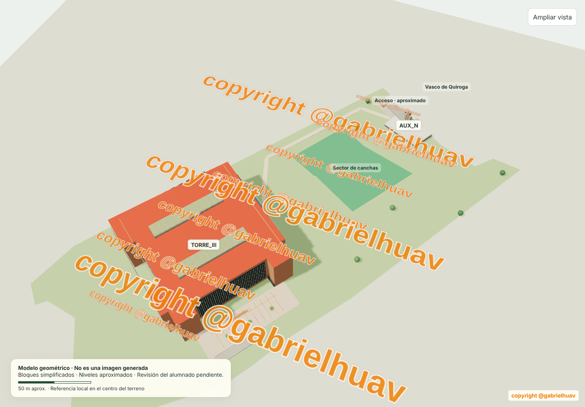 |  |
| Ágora | (Daniela) | (Daniela) |
| Canchas | 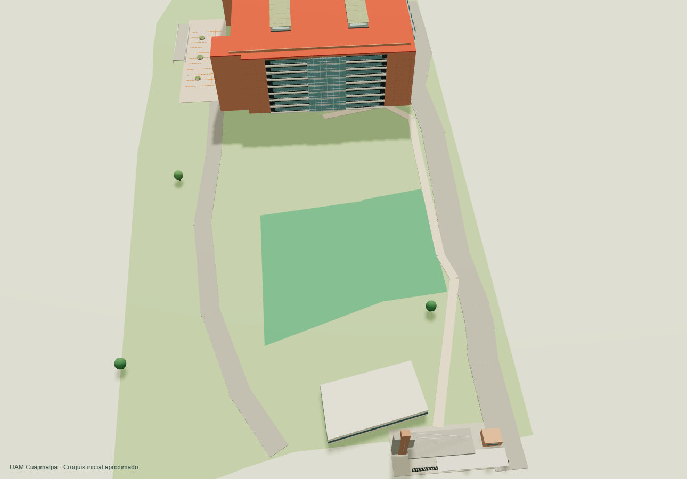 | 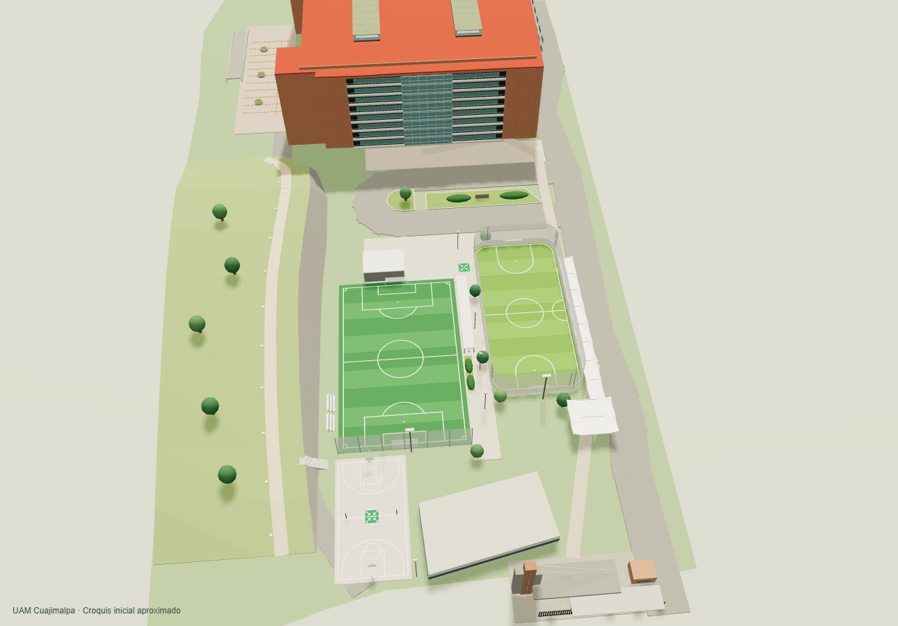 |

### Planes de fotos

Los planes están en [`docs/plan-de-fotos/`](docs/plan-de-fotos/). Cada uno indica desde qué puntos se fotografía, cuántas fotos se tomarán, cuándo, cómo se nombran los archivos y los riesgos con su respuesta. Las fotos no se suben al repositorio.

| Parte | Plan |
| --- | --- |
| Entrada y caminos | [entrada-y-caminos.md](docs/plan-de-fotos/entrada-y-caminos.md) |
| Ágora | (Daniela) |
| Canchas | [canchas.md](docs/plan-de-fotos/canchas.md) |

### Referencias de la Práctica 3

Conventional Commits. (s. f.). *Conventional Commits 1.0.0*. https://www.conventionalcommits.org/es/v1.0.0/

GitHub. (s. f.). *Linking a pull request to an issue*. GitHub Docs. https://docs.github.com/en/issues/tracking-your-work-with-issues/using-issues/linking-a-pull-request-to-an-issue

Hurtado Avilés, G. (2026). *navegacion-uam-equipo-00* [Software]. GitHub. https://github.com/gabrielhuav/navegacion-uam-equipo-00

OpenStreetMap contributors. (s. f.). *OpenStreetMap*. https://www.openstreetmap.org/copyright

## Uso de inteligencia artificial

Se utilizó Claude (Anthropic) para elaborar borradores de documentos del repositorio. Se utilizó Codex (OpenAI) para apoyo en el rediseño visual de la app Android y en la redacción inicial de este README. En la Práctica 3 (canchas), se utilizó Claude (Anthropic) para medir las canchas y caminos sobre la imagen satelital, programar su modelo en el visor del campus, generar el mapa de puntos del plan de fotos y redactar borradores del issue, del Pull Request y del plan. El equipo revisó, adaptó y validó el código y la documentación resultantes.

## Referencias

Docker. (s. f.). *Docker Compose documentation*. https://docs.docker.com/compose/

Fielding, R. T. (2000). *Architectural styles and the design of network-based software architectures* [Tesis doctoral, University of California, Irvine]. https://ics.uci.edu/~fielding/pubs/dissertation/top.htm

Flutter. (s. f.). *Flutter documentation*. https://docs.flutter.dev/

Google. (s. f.). *Android Developers*. https://developer.android.com/

Hurtado Avilés, G. (2026). *Práctica 1: App móvil con API REST, usuarios y Docker* [Guía de práctica]. Universidad Autónoma Metropolitana, Unidad Azcapotzalco.

Jones, M., Bradley, J., & Sakimura, N. (2015). *JSON Web Token (JWT)* (RFC 7519). Internet Engineering Task Force. https://doi.org/10.17487/RFC7519

OWASP Foundation. (s. f.). *Password storage cheat sheet*. OWASP Cheat Sheet Series. https://cheatsheetseries.owasp.org/cheatsheets/Password_Storage_Cheat_Sheet.html
