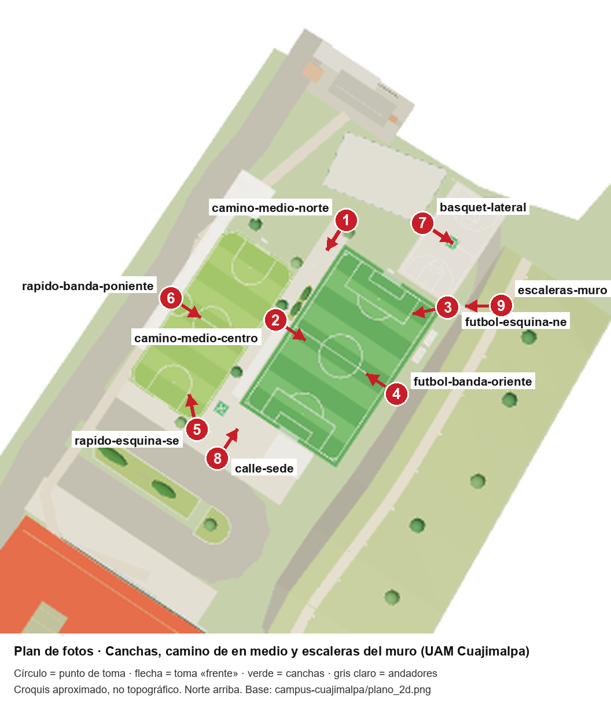

# Plan de fotos · Canchas, camino de en medio, escaleras del muro y calle frente a la sede

Responsable: Max Uriel Sánchez Díaz · Unidad Cuajimalpa · Práctica 3 · Mi parte del campus · Issue [#38](https://github.com/maxitodev/proyectos-integradores-uam_a/issues/38)

Las fotos sirven para confirmar en campo la cancha de fútbol, la de fútbol rápido, la de básquetbol, el camino de en medio, la carpa del andador, el muro con sus escaleras y la calle frente a la sede, y más adelante para entrenar el reconocimiento del lugar con la cámara. Por ahora **sólo se planea**: todavía no se toman. **Las fotos no se suben al repositorio**; se guardan en la carpeta compartida del equipo.

## Puntos de toma



El círculo marca dónde se para quien toma la foto y la flecha, hacia dónde mira la toma de frente. El croquis es aproximado: en campo manda lo que se ve.

| Punto | Nombre en archivo | Dónde | Qué debe verse de frente |
| --- | --- | --- | --- |
| 1 | `camino-medio-norte` | Inicio del camino de en medio, junto al estacionamiento | El camino entre las dos canchas, con sus árboles y luminarias, hasta la sede |
| 2 | `camino-medio-centro` | A media cancha, sobre el camino de en medio | La cancha de fútbol de lado, con el seto en primer plano |
| 3 | `futbol-esquina-ne` | Esquina de la cancha de fútbol junto a la cancha de básquetbol | La cancha de fútbol en diagonal, con la portería norte y la torre de luz |
| 4 | `futbol-banda-oriente` | Franja junto al muro de contención, a media cancha | La cancha de fútbol de lado y, al fondo, el camino de en medio y la de fútbol rápido |
| 5 | `rapido-esquina-se` | Esquina de la cancha de fútbol rápido, en la explanada sur | La cancha de fútbol rápido en diagonal, con su portería sur |
| 6 | `rapido-banda-poniente` | Bajo la carpa del andador, junto al camino de los coches, a media cancha de fútbol rápido | El muro blanco y la red de la cancha de fútbol rápido; con `izq` y `der`, la carpa a lo largo |
| 7 | `basquet-lateral` | Orilla de la cancha de básquetbol del lado del estacionamiento | La cancha de lado, con los dos tableros, los postes rojos y el punto de reunión |
| 8 | `calle-sede` | Orilla sur de la explanada, junto a la guarnición de la calle frente a la sede (sin bajar al arroyo) | Las canchas desde el sur, con la techumbre y la jardinera larga a un lado |
| 9 | `escaleras-muro` | Arriba del muro de contención, al final de las escaleras que suben desde la cancha de básquetbol | Las escaleras y, abajo, la cancha de fútbol con sus gradas; con `izq`, el andador sobre el muro |

## Condiciones

El enunciado pide variar ángulo, cámara, hora, clima y gente. Cada condición se cubre así:

| Condición | Variantes | Cómo se cubre |
| --- | --- | --- |
| Ángulo | Frente, laterales y esquinas; de cerca y de lejos; a la altura de los ojos y desde abajo | Los puntos 3 y 5 son esquinas; en cada punto se toma la serie de 7 tomas de abajo |
| Cámara | Al menos dos teléfonos distintos; vertical y horizontal | Teléfono A (Max) toma la serie completa; teléfono B (otro integrante, otra marca) repite `frente` y `lejos`. La serie incluye una toma vertical |
| Hora | Mañana, mediodía, tarde y noche | Sesiones 1 a 4 |
| Clima | Soleado, nublado y con lluvia | Al menos una de las sesiones 1 a 4 debe ser soleada; las sesiones 5 y 6 esperan un día nublado y uno con lluvia |
| Gente | Sin gente y con gente, sin rostros reconocibles | La sesión 1 es antes de clases (sin gente); las sesiones 2 y 3 son en horas de partido o de paso (con gente) |

### Serie de tomas por punto

| Toma | Nombre en archivo | Cómo | Teléfono |
| --- | --- | --- | --- |
| Frente | `frente` | Horizontal, a la altura de los ojos, hacia donde apunta la flecha | A y B |
| Frente vertical | `frente-v` | Igual que `frente`, con el teléfono vertical | A |
| Izquierda | `izq` | Girando a la izquierda, para que entre el costado o la esquina | A |
| Derecha | `der` | Girando a la derecha | A |
| De cerca | `cerca` | Cinco pasos hacia la flecha, para ver el detalle (líneas, portería, tablero, árboles) | A |
| De lejos | `lejos` | Cinco pasos hacia atrás, para ver el contexto | A y B |
| Desde abajo | `abajo` | De frente, con el teléfono a la altura de la rodilla, inclinado hacia arriba | A |

Por punto y sesión: 7 fotos del teléfono A + 2 del teléfono B = **9 fotos**. Con 9 puntos, **81 fotos por sesión**.

## Cuántas y cuándo

| Sesión | Fecha | Hora | Hora del día | Clima | Gente | Fotos |
| --- | --- | --- | --- | --- | --- | --- |
| 1 | Lunes 26 de octubre de 2026 | 7:30 a 8:15 | Mañana | El que toque (se anota) | Sin gente | 9 puntos × 9 = 81 |
| 2 | Lunes 26 de octubre de 2026 | 13:00 a 13:45 | Mediodía | El que toque | Con gente | 81 |
| 3 | Miércoles 28 de octubre de 2026 | 16:30 a 17:15 | Tarde | El que toque | Con gente | 81 |
| 4 | Miércoles 28 de octubre de 2026 | 18:45 a 19:30 | Noche (después de la puesta de sol, hacia las 18:05) | El que toque | Con poca o sin gente | 81 |
| 5 | Primer día nublado entre el 26 de octubre y el 6 de noviembre de 2026 | Mañana o tarde | La que permita el horario de clases | Nublado | Indistinto | 81 |
| 6 | Primer día con lluvia entre el 26 de octubre y el 13 de noviembre de 2026 | Durante la lluvia o justo después, con el piso mojado | La que toque | Lluvia | Sin gente (las canchas se vacían) | 81 |
| | | | | | **Total** | **486** |

En la sesión 4 se fotografían las canchas con las torres de luz encendidas, si lo están. Si ninguna de las sesiones 1 a 4 es soleada, la sesión 2 se repite en un día soleado antes del 6 de noviembre.

## Nombres de archivo

```
canchas_<punto>_<toma>_<hora>_<clima>_<gente>_<telefono>_<nn>.jpg
```

- `<hora>`: `manana`, `mediodia`, `tarde`, `noche`.
- `<clima>`: `sol`, `nublado`, `lluvia`.
- `<gente>`: `sin-gente`, `con-gente`.
- `<telefono>`: `tel-a`, `tel-b`.

Ejemplos: `canchas_basquet-lateral_frente_noche_lluvia_sin-gente_tel-a_01.jpg`, `canchas_camino-medio-norte_frente-v_manana_sol_sin-gente_tel-a_01.jpg`, `canchas_futbol-esquina-ne_lejos_mediodia_nublado_con-gente_tel-b_02.jpg`.

Sin acentos, eñes ni espacios. Cada sesión va en su carpeta, por ejemplo `s1_2026-10-26_manana/`. En la misma carpeta se guarda `registro.txt` con fecha, hora de inicio y fin, clima observado y modelo de cada teléfono.

## Riesgos y respuesta

| Riesgo | Respuesta |
| --- | --- |
| No llueve antes de la fecha (la temporada de lluvias termina en octubre) | La sesión 6 queda abierta hasta el 13 de noviembre; si no llueve, se anota el faltante en el registro y se toma con la primera lluvia. No se simula la lluvia |
| Las canchas están ocupadas con partidos | Se toma entre partidos o desde la orilla, sin entrar ni interrumpir el juego |
| Aparece un rostro reconocible | Se toma de lejos o se espera a que pase; la foto con rostro se borra el mismo día |
| De noche las torres de luz están apagadas o la unidad está por cerrar | Se toma a partir de las 18:45 y antes de las 19:30, en pareja; si están apagadas se anota en el registro |
| Vigilancia no permite fotografiar | Se muestra la credencial UAM y se explica que es para una práctica; si no se autoriza, se pide permiso por correo a la coordinación y se reprograma |
| No hay segundo teléfono ese día | Se le pide a otro integrante; si nadie puede, se repite `frente` y `lejos` en la siguiente sesión con otro teléfono |
| La lluvia moja el teléfono | Funda o bolsa transparente; el punto 6 queda bajo la carpa del andador; en los demás se toma con paraguas o entre aguaceros |
| Pasan coches por la calle frente a la sede (punto 8) | Se toma desde la orilla de la explanada, sin bajar a la calle; si llega un coche, se espera a que pase |
| Las escaleras o el andador sobre el muro están mojados o cerrados | De noche y con lluvia el punto 9 se toma desde el pie de las escaleras, sin subir |
| Se pierden las fotos | Se suben a la carpeta compartida el mismo día |
| Las canchas, el camino o la calle reales no coinciden con el croquis | Se anota la diferencia con la foto que la muestra y se abre un issue para corregir el croquis |

## Uso de IA

Se usó Claude (Anthropic) para redactar un borrador de este plan y generar el mapa de puntos a partir del plano del croquis. Max revisó y ajustó los puntos, las tomas, las fechas y los riesgos.
