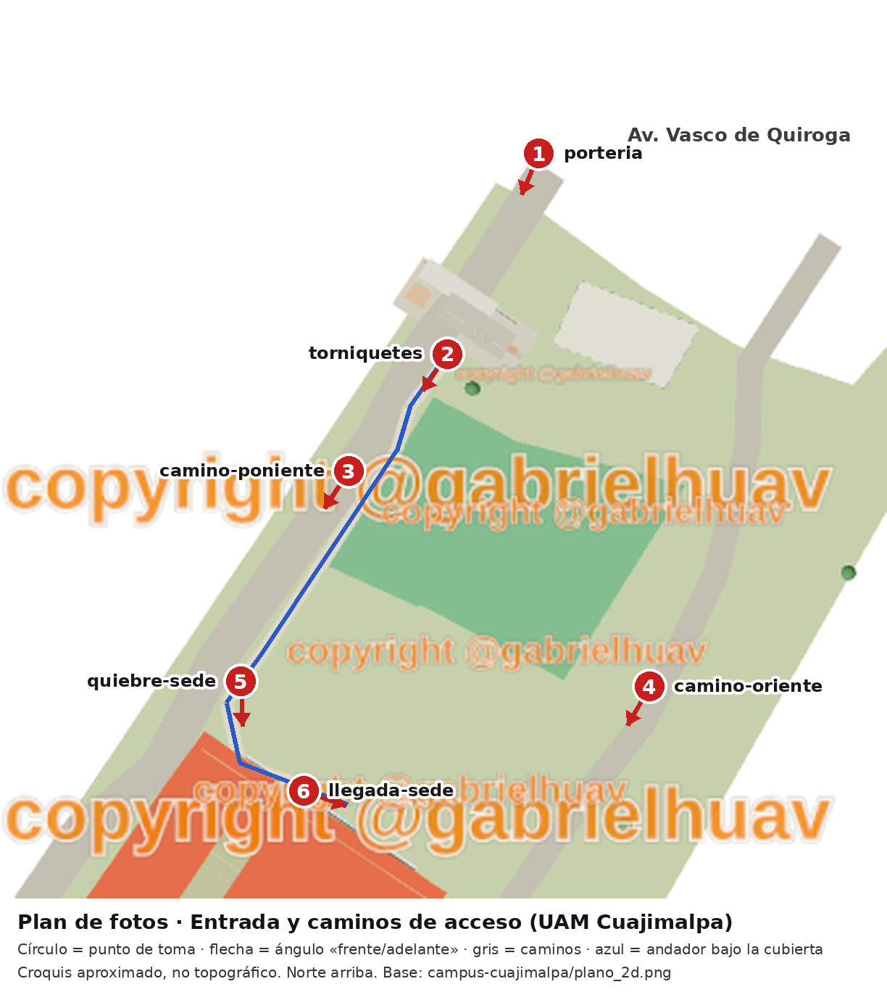

# Plan de fotos · Entrada (portería) y caminos de acceso

Responsable: Bryan Tonatiuh Ochoa De La Cruz · Unidad Cuajimalpa · Práctica 3 · Mi parte del campus

Las fotos sirven para confirmar en campo la posición de la portería, los dos caminos vehiculares (poniente y oriente, trazados sobre imagen satelital y contrastados con Street View 2019 y fotos 360° públicas) y el andador techado que lleva de Av. Vasco de Quiroga a la sede principal (Torre III), pasando junto al sector de canchas. **Las fotos no se suben al repositorio**; se guardan en una carpeta compartida del equipo y aquí solo queda el plan.

## Puntos de toma



El círculo marca dónde se para quien toma la foto y la flecha el ángulo «frente» o «adelante». Las posiciones vienen del croquis (`campus-cuajimalpa/campus_editado.json`), que es aproximado; en campo se usa la referencia física de la última columna.

| Punto | Nombre en archivo | Dónde | Referencia física para repetir el encuadre | Ángulos |
| --- | --- | --- | --- | --- |
| 1 | `porteria` | Arranque del camino de entrada desde Av. Vasco de Quiroga, a unos 40 m de la portería (mismo lugar que el Street View de la avenida) | Borde de la banqueta donde empieza el camino de entrada | `frente`, `izq` (45° a la izquierda), `der` (45° a la derecha) |
| 2 | `torniquetes` | Lado interior de la portería, junto a los torniquetes | Pedestal del torniquete central | `frente` (hacia el campus), `contra` (hacia la avenida), `lateral` (hacia la caseta) |
| 3 | `camino-poniente` | Camino vehicular poniente, junto al muro de contención, a la altura del inicio de la cubierta del andador | Primer poste de la cubierta | `adelante` (hacia la sede), `atras` (hacia la portería), `lateral` (hacia las canchas) |
| 4 | `camino-oriente` | Camino vehicular oriente (acceso secundario desde la avenida), donde se estacionan autos, frente a las canchas | Primer cajón de estacionamiento del tramo | `adelante`, `atras` |
| 5 | `quiebre-sede` | Fin de la cubierta del andador, donde gira hacia la sede | Último poste de la cubierta | `adelante`, `atras` |
| 6 | `llegada-sede` | Llegada al acceso de la sede principal (Torre III) | Primer escalón o rampa de la sede | `adelante` (hacia el acceso), `atras` (hacia el camino) |

Reglas para que las sesiones sean comparables: teléfono a la altura de los ojos (aprox. 1.5 m), sin zoom digital, lente principal (1×), sin filtros ni modo retrato, HDR automático. En la primera sesión se toma una foto de referencia por punto y ángulo; en las siguientes se abre esa foto para repetir el encuadre.

## Cámaras

Dos teléfonos, `tel1` y `tel2`. En la primera sesión se anotan marca y modelo de cada uno en la hoja de registro. Cada toma se repite en vertical (`v`) y horizontal (`h`).

## Cuántas fotos por condición

Hay dos tipos de sesión:

- **Completa:** todos los ángulos, con los dos teléfonos y las dos orientaciones. Puntos 1–3: 3 ángulos × 2 teléfonos × 2 orientaciones = 12 fotos por punto (36). Puntos 4–6: 2 × 2 × 2 = 8 por punto (24). **60 fotos.**
- **Reducida:** todos los ángulos, solo `tel1`, en las dos orientaciones. Puntos 1–3: 6 por punto (18); puntos 4–6: 4 por punto (12). **30 fotos.**

| # | Hora | Clima | Gente | Sesión | Fotos |
| --- | --- | --- | --- | --- | --- |
| S1 | Mañana (7:15–8:00) | Soleado | Sin gente | Completa | 60 |
| S2 | Mediodía (13:00–13:45) | Soleado | Con gente | Completa | 60 |
| S3 | Tarde (17:00–17:45) | Soleado | Con gente | Completa | 60 |
| S4 | Noche (19:15–20:00) | Despejado o nublado | Sin gente | Completa | 60 |
| S5 | Mañana (7:15–8:00) | Nublado | Sin gente | Reducida | 30 |
| S6 | Tarde (17:00–17:45) | Nublado | Con gente | Reducida | 30 |
| S7 | Tarde o noche, cuando ocurra | Lluvia | Con o sin gente | Reducida | 30 |
| S2+ | Mediodía, en el cambio de clase | Soleado | Con y sin gente | Par adicional | 12 |
| | | | | **Total** | **342** |

El par adicional de S2 compara el mismo encuadre con y sin gente: en cada punto, ángulo `frente`/`adelante`, `tel1` horizontal, una foto durante el cambio de clase (a la hora en punto) y otra cuando el camino se vacía (6 puntos × 2 = 12).

**Gente sin rostros:** las personas aparecen de espaldas, de lado o a más de 15 m; si un rostro o una placa de auto quedan reconocibles, la foto se repite. No se fotografía al personal de vigilancia ni el interior de la caseta.

## Cuándo

| Fecha (2026) | Sesiones | Nota |
| --- | --- | --- |
| Lunes 26 de octubre | S1 y S2 | Si amanece nublado, se hace S5 en lugar de S1 y S1 pasa al jueves 29 |
| Miércoles 28 de octubre | S3 y S4 | Ir en pareja a S4 |
| Primer día nublado entre el 26 y el 30 de octubre | S5 y S6 | Se revisa el pronóstico del Servicio Meteorológico Nacional la noche anterior |
| Primera tarde con lluvia entre el 26 de octubre y el 13 de noviembre | S7 | Ventana larga porque a finales de octubre la lluvia ya es menos frecuente |
| A más tardar 13 de noviembre | Revisión | Se completa la hoja de registro y se marcan las faltantes |

Se evitan el 1 y 2 de noviembre (posibles días inhábiles) y se confirma en el calendario de la UAM que la unidad esté abierta.

## Nombres de archivo

```
<zona>_<punto>-<ángulo>_<hora>_<clima>_<teléfono>-<orientación>_<gente>_<nn>.jpg
```

| Campo | Valores |
| --- | --- |
| `zona` | `entrada` (puntos 1 y 2), `caminos` (puntos 3–6) |
| `punto` | `porteria`, `torniquetes`, `camino-poniente`, `camino-oriente`, `quiebre-sede`, `llegada-sede` |
| `ángulo` | `frente`, `izq`, `der`, `contra`, `lateral`, `adelante`, `atras` |
| `hora` | `manana`, `mediodia`, `tarde`, `noche` |
| `clima` | `soleado`, `nublado`, `lluvia` |
| `teléfono-orientación` | `tel1-v`, `tel1-h`, `tel2-v`, `tel2-h` |
| `gente` | `congente`, `singente` |
| `nn` | `01`, `02`… si se repite la toma |

Ejemplos:

- `entrada_porteria-frente_noche_lluvia_tel1-h_singente_01.jpg`
- `entrada_torniquetes-contra_mediodia_soleado_tel2-v_congente_01.jpg`
- `caminos_camino-oriente-adelante_manana_nublado_tel1-v_singente_01.jpg`

Sin acentos, eñes ni espacios. Las fotos se organizan en carpetas por sesión (`S1_2026-10-26_manana/`).

## Hoja de registro

Por cada sesión se llena una fila, en la carpeta compartida (no en el repositorio):

| Sesión | Fecha | Hora de inicio y fin | Clima observado | tel1 / tel2 (modelo) | Fotos tomadas | Faltantes y motivo |
| --- | --- | --- | --- | --- | --- | --- |

## Riesgos y respuesta

| Riesgo | Respuesta |
| --- | --- |
| No llueve en la ventana | Se mantiene abierta hasta el 13 de noviembre; si no llueve, S7 se hace con piso mojado después de una lluvia nocturna o se reporta como faltante en la hoja de registro |
| Vigilancia no permite fotografiar el acceso | Se muestra la credencial UAM y se explica que es para una práctica; si no se autoriza, los puntos 1 y 2 se toman desde la banqueta exterior y se anota la restricción |
| Aparecen rostros o placas reconocibles | Se espera a que pasen o se repite la toma de espaldas; la foto con rostro se borra y no se usa |
| La salida nocturna es insegura o la unidad cierra antes | S4 se hace en pareja, sin invadir el arroyo vehicular de Vasco de Quiroga; si el acceso ya está cerrado, solo se toma el punto 1 desde la banqueta |
| El segundo teléfono no está disponible | La sesión se mueve a otro día de la misma semana; si no se puede, se hace con `tel1` y se registra |
| Los encuadres no coinciden entre sesiones | Se usa la foto de referencia de S1 y la referencia física de cada punto |
| Batería o memoria insuficiente | Cargar ambos teléfonos y dejar al menos 2 GB libres antes de salir |
| Lluvia daña el equipo | Funda o bolsa hermética; en S7 se toman primero los puntos con techo (portería) |
| La portería, los caminos o el andador reales no coinciden con el croquis | Se anota la diferencia (en metros y con la foto que lo muestra) y se propone como siguiente corrección del croquis en un issue nuevo |

## Uso de IA

Se usó Claude (Anthropic) para redactar un borrador de este plan y generar el mapa de puntos a partir del plano del croquis. Bryan revisó los puntos, las cantidades, las fechas y los riesgos.
